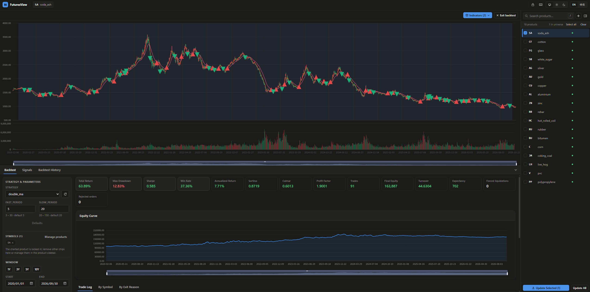

# FuturesView

**A chart-first research workspace for Chinese commodity futures** on **CZCE**, **SHFE**, and **DCE**, running locally in your browser on top of a daily-bar backtesting engine.

<picture>
  <source media="(prefers-color-scheme: dark)" srcset="docs/assets/webui-dark.png">
  <source media="(prefers-color-scheme: light)" srcset="docs/assets/webui-light.png">
  
</picture>

## Features

- **Specialized for Futures Market.** Signals compute on a smooth open-interest–weighted continuous series while orders fill on actual rolling main contracts, with contract multipliers, margin, commissions, roll rules, and forced liquidation settings.
- **All-in-One Workspace.** Manage data downloads, overlay indicators, track signal snapshots, and run backtests in a single screen where fills, roll points, equity curves, and trade logs all stay linked to the same chart.
- **Your Panel, Your Way.** Drop your own Python class into `indicators/` or `strategies/` and hot-reloaded parameter spaces automatically become interactive UI controls and chart panes, alongside editable product specs and signals.

## Quick Start

Requirements: Python 3.11+, and Node.js 20.19+ to build the frontend.

Install the engine and the web server.

```bash
git clone https://github.com/FINTERIGION/futures-view.git
cd futures-view
pip install -e ".[web]"
```

Build the frontend once.

```bash
cd webui
npm install
npm run build
cd ..
```

DCE needs credentials ([apply here](http://www.dce.com.cn/dce/channel/list/7000198.html)) for historical data.

```bash
export DCE_API_KEY=...
export DCE_SECRET=...
```

Start the panel, then open [http://127.0.0.1:8888](http://127.0.0.1:8888).

```bash
python main.py web
```

## Command Line

The same functions also run without a browser. Backtest outputs (charts, trade log) land in `results/`.

```bash
python main.py data
python main.py backtest --symbols CF FG --start 2020-01-01 --end 2026-12-31 --strategy double_ma --cash 100000
```

## Documentation

| Page                                      | Contents                                                                                       |
| ----------------------------------------- | ---------------------------------------------------------------------------------------------- |
| [Data Pipeline](docs/data.md)             | `main.py data` CLI, exchange cache & CSV outputs, `datafeed/products.json` registry schema     |
| [Backtesting](docs/backtest.md)           | `main.py backtest` CLI, four-phase execution model, roll & margin rules, outputs, metrics      |
| [Writing a Strategy](docs/strategy.md)    | `Strategy` lifecycle, `SetupContext` / `BarContext` API, OCO protective bracket, conventions   |
| [Writing an Indicator](docs/indicator.md) | `Indicator` class attributes, `Output` styling & color tokens, `IndicatorContext`, HTTP API    |
| [Web Panel](docs/web.md)                  | `main.py web` CLI, frontend build/dev, workspace modules, HTTP routes, security & job guards   |
| [Project Layout](docs/architecture.md)    | Repository directory tree, test suite, and lint commands                                       |
